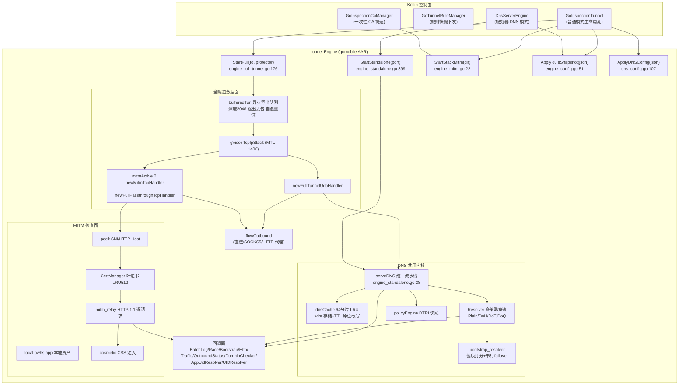

# 10. Go 隧道引擎（数据面）

## 10.1 概述

`Android/tunnel` 是一个用 gomobile/bind 编译为 `libs/tunnel.aar`、由 Kotlin 直接调用的 Go 数据面库。它承担 DITING 普通（Inspect）模式与服务器 DNS 模式的全部 DNS 处理、规则判定、TUN 流量转发与 HTTPS MITM 检查。所有导出 API 严格遵守 gomobile 可绑定类型（string / []byte / int / bool / error），复杂结构一律走 JSON 字符串或回调接口。

包级文档见 `engine.go:1-34`（GC 调优、并发与拆除架构说明）与 `engine_full_tunnel.go:1-15`（全隧道架构与死锁消除说明）。核心设计约束：

- `init()` 设 `debug.SetGCPercent(400)`（`engine.go:36-38`），刻意不设软内存上限，换取高频小包 DNS 负载下约 4 倍更少的 GC 周期。
- 数据面有三条互斥的运行形态：全隧道 `StartFull`（TUN+gVisor）、纯 DNS 服务器 `StartStandalone`（udp/tcp :port）、旧版拦截器 `Start`（**生产零调用者**，见 10.9）。MITM 通过 `StartStackMitm` 在 `StartFull` 之前挂载。
- 策略判定有两种实现：现役的 `policyEngine` DTRI 快照（`applyRuleSnapshot`）与遗留的原生 mmap trie+bloom（`SetTries` 系，**同样零生产调用者**）。

消费方仅 5 个 Kotlin 文件（import tunnel）：
`normal/GoInspectionTunnel.kt`、`normal/GoTunnelRuleManager.kt`、`normal/GoInspectionResolvers.kt`、`core/cert/GoInspectionCaManager.kt`、`server/backend/DnsServerEngine.kt`。Express 模式不走 Go 引擎（Kotlin 侧 ExpressDnsEngine 独立实现）。

## 10.2 架构总图

## 10.3 子系统逐个详解

### A. 引擎生命周期与会话代际（engine.go / engine_lifecycle_test.go / engine_session_race_test.go）

- `Engine` 结构体 `engine.go:40-130`，`NewEngine()` `engine.go:132-152`：默认 `responseType=ResponseCustomIP`、`filterDNS=true`、`blockEncryptedDNS=true`（**fail-closed**：从未收到 `SetBlockEncryptedDns` 的数据面继续封 DoT，注释 `engine.go:145-148`）、DNS 缓存启用、`ipDomainCache` 2048 条。
- `StartFull(fd int, protector SocketProtector)` `engine_full_tunnel.go:176-326`：
  1. 持锁：`running` 守卫、计数归零、`connLogSeen.reset()`（:187）、`protectFn`、`newFlowOutbound`（:194）、预报 outbound 状态 connecting/disabled（:196-198）、新建 Resolver 并注入 race/bootstrap 回调与 outbound（:200-203）、`dnsConfig` 快照优先否则 legacy `Configure`（:204-211）、捕获 `gen := e.sessionGen`（:223）后放锁。
  2. 锁外昂贵操作：`dupFd`（:242，Windows 为测试 no-op）、建栈、装 handler、`newBufferedTun`。
  3. 重新持锁后用 `stillCurrent() = e.running && e.sessionGen == gen`（:228）判定是否认领 `tunFile`/`tcpStack` 槽位；不是则 `btun.halt()+tunFile.Close()` 放弃（:273-283）——这正是修复 "StartFull 晚于 Stop 落地导致 TUN 栈泄漏到进程死亡" 的代际守卫（O-104，`engine.go:228-237` 注释；测试 `engine_session_race_test.go:18-73`）。
  4. `stack.Start(btun, 1400)` 失败回滚（:285-298）；随后 `trafficTracker.Start()`、`logAggregator.start()`，阻塞 `<-done`，退出时兜底 `stack.Stop()`（:307-325，注释解释 Stop 早于栈安装时槽位为 nil 够不着）。
- `Stop()` `engine.go:225-368`：**故意不对 `!running` 早退**——它同时释放 `dnsCache.close()` 与 `stackCertMgr.Release()`（A-017：CA 助手每次铸证新建一个 Engine，idle Stop 必须能回收 30s ticker 与证书缓存）；`sessionGen++`（:236）使在途 StartFull 失效；锁外执行全部 Shutdown（resolver、standalone 四服务器、pipe、fullDone、stack、aggregator、tracker、policyEngine），每一步幂等。
- `ReleaseTun()` `engine.go:215-223`：单独关 TUN 文件（Kotlin 在 VPN 断开后调用，`GoInspectionTunnel.kt:110`）。
- 注释债：`engine.go:93` 写 "See claimFullTunnelSession"，但全仓不存在该符号（grep 仅此注释一处命中）——过时引用。

### B. 全隧道数据面与 TUN 写出（engine_full_tunnel.go / packet_pipe.go）

- `bufferedTun` `:32-174`：读侧直通 `*os.File`；写侧 `Write` **永不报错**（gVisor iobased endpoint 丢弃错误也不重试，报错只会丢包，注释 :88-90），从 `tunPacketPool`（sync.Pool，容量 MTU）取缓冲塞进深度 2048 的 `out` 通道，满则丢弃并限频计数（`n<=3 || n%1024==0`）。
- `drain()` `:113-129` + `writeWithRetry` `:133-170`：写失败视为瞬态（Wi-Fi/蜂窝切换的 ENETDOWN/EINVAL/EBUSY 窗口，注释 :53-55），健康态每包最多 40 次退避（5ms 起、倍增封顶 100ms）；预算耗尽**丢包但保活**，置 `healthy=false` 后只单探一次，成功即恢复——修复了"一次写错误永久杀死出站、只重开 VPN 才能恢复"的旧缺陷。
- 常量：`defaultTunMTU=1400`（engine_mitm.go:18）、`tunWriteQueueDepth=2048`（:49）、`tunPooledMaxPacketBytes=2*MTU`（:51，超尺寸包回池外）、重试参数 `:56-58`。
- `newFullTunnelUdpHandler` `:328-375` 判定顺序：`isUIDBlocked` → 端口 53 走 `handleDNSOverUDP` → `shouldBlockEncryptedDNS(853)` → `appAllowlistConnectionAllowed` → `logConnection` → **quicDrop**：`SetFilterHttp3` 打开且 filter 激活且该 UID 在 MITM 白名单时丢弃 UDP 443（记 `quic_forced_tcp`），逼 HTTP/3 回落 TCP 供 MITM 检查 → `flowOutbound.DialUDP`（10s `flowDialTimeout`，tcp_stack_handlers.go:22）→ `trafficTracker.WrapClientConn` → `relayUDPFlow` 双向滚动 deadline（默认 UDP 空闲 30s）。
- `newFullPassthroughTcpHandler` `:377-404`：同序但 53 走 `handleDNSOverTCP`，其余 `relayDirectFromFlow` 双向拷贝带 CloseWrite 半关语义。
- `SetBlockedUIDs` CSV 解析 `:430-441`（仅正整数）；`isUIDBlocked` `:443-451`（`UIDUnknown=-1` 永不阻断，socket_uid_resolver.go:21）。
- packet_pipe.go（`packetQueueDepth=1024` :19）只服务 legacy `Start` 的 `tcpStackPipe` 路径，现役全隧道不再使用。

### C. DNS 传输层：TUN 内 UDP/TCP 53 与裸服务器（engine_dns_transport.go / engine_standalone.go）

- `handleDNSOverUDP`：15s 空闲窗口（`dnsUDPIdleTimeout` :21）读循环；`RecordTx(uid)` 计上行；`serveDNS` 经 `udpDNSResponseWriter`，`WriteMsg/Write` 时 `RecordRx`。
- `handleDNSOverTCP`：2 字节长度前缀分帧，15s 空闲 + 写 deadline（`dnsTCPIdleTimeout` :78）；`tcpDNSResponseWriter.writeBytes` 负责补前缀。
- `StartStandalone(port)` `engine_standalone.go:399-514`：持锁拆除旧 standalone 服务器与 resolver、`running=true`、计数归零、`NewResolver(nil protectFn)`（**standalone 不 protect 套接字**，本机 53 端口服务不会回环进自身 TUN）、下发 dnsConfig 或 legacy Configure；放锁后 Shutdown 旧实例；`udp4/tcp4 0.0.0.0:port` 绑定失败即返回错误，`udp6/tcp6 [::]:port` 失败仅记日志跳过（IPv6 可选降级）；四个 `dns.Server{Handler: dns.HandlerFunc(e.ServeDNS)}` 各自 goroutine `ActivateAndServe`。`StopStandalone` `:516-547` 只关服务器不动会话。
- `ServeDNS`（导出，gomobile 直接可绑，:24）→ `serveDNS(w, r, appOverride, uid)`（:28-250）是**全隧道与 standalone 共用的唯一 DNS 流水线**（full-tunnel 经 transport 层调 serveDNS，standalone 经 miekg/dns Handler 调之）。
- `standaloneBlock` `:252-279` 按 `effectiveBlockResponseType(domain)` 分支：NXDOMAIN / REFUSED / NODATA（RcodeSuccess 无应答）/ 默认黑洞 0.0.0.0 或 ::（TTL 300）。
- `standaloneForward` `:281-397`：`getFast` 命中→`checkResponseChainTargets` 反劫持→改写 ID/TTL 直接 Write（记 cached）；过期且允许 stale→先回 stale 再异步 singleFlight 刷新（RFC 8767 stale-while-revalidate）；未命中→`resolver.Resolve`，错误→stale 兜底→SERVFAIL；应答含 sinkhole 特征（A/AAAA 全零或回环）→按 blocked 归因；`checkResponseChain` 对 CNAME/SVCB 目标二次规则匹配；`respMsg.Id=r.Id` 回填；`rememberAppAllowlistResponse` 记 IP 授权；`notifyLogWithTTL` 出日志。

### D. 规则判定：policyEngine 快照与遗留 trie+bloom（policy_engine.go / rule_compiler.go / domain_trie.go / domain_bloom_filter.go / policy_dtri_reader.go）

- 现役路径 `ApplyRuleSnapshot(json) string`（engine_config.go:51，返回错误串而非 error 以兼容 gomobile）→ `ruleSnapshotJSON`（policy_engine.go:57-76）字段与 Kotlin `DomainPolicyEngine.kt:118-250` 快照生成器一一对偶：`filterEnabled/blockTriePath/importantBlockTriePath/allowTriePath/importantAllowTriePath/globalAllow/globalBlock/globalImportant/appRules/invertedBlock/invertedAllow/specialBlock/specialAllow/disabledRules`。
- `policySnapshot.evaluate(domain, appName, qtype) (blocked, reason)` 走 `atomic.Pointer` 无锁读（policy_engine.go:20-54）；special 规则支持 regex（自动加 `(?i)`，policy_engine.go:100-109）、`appScope/appInverted/denyallow/dnsType/isWildcard`；DTRI 文件由 **Kotlin 侧写入**（见章节 02），Go 侧 `openDTRI` 校验 36B 头、12B node/edge、内嵌 bloom、7 个 FNV 变体 hash（policy_dtri_reader.go），`containsOrParentWithDisabled` 逆序标签逐级查后缀并处理 `*` 通配与 disabledRules；reader 延迟 2s 关闭（policy_engine.go:428-430, 475-477）。
- 二进制格式常量：旧 trie `trieMagic="TRIE" 0x54524945`、`trieVersion=2`、`headerSize=16`（domain_trie.go:19-21）；bloom `bloomMagic="BLOOM"`、version 1、24B 头、双哈希 FNV-1a/1b（h2 强制奇数），头注释声明 Go↔Kotlin 哈希必须逐位一致（domain_bloom_filter.go:17）；DTRI magic 0x44545249 version 1。
- 遗留路径 `SetTries/SetImportantTries/CompileFilterList*/LoadMmapTrie/LoadBloomFilter`：`hasNativeRules/hasImportantRules` 只能由这两个 setter 置真，而二者**全仓零调用者**→原生 trie+bloom 判定在生产不可达（rule_compiler.go 仍被 applyRuleSnapshot 的编译流程复用，不能删文件本身）。`engine_standalone.go:197-247` 的原生扫描分支因此是死分支；且该分支在锁外读 `e.secTrieIDs/adTrieIDs`（:217/:236），若 setter 复活即为数据竞争——现网不可达故仅记录。

### E. MITM 检查面（engine_mitm.go / mitm_handler.go / mitm_filter.go / mitm_cert_manager.go / mitm_relay.go / mitm_trust.go / mitm_sniffer.go / mitm_common.go）

- `StartStackMitm(certDir) string` engine_mitm.go:22：加载/生成根 CA（`ca.crt/ca.key`，org "DITING"，CN "DITING HTTPS Inspection Root CA"），建 `CertManager`+`MitmFilter` 挂到 `e.stackCertMgr/stackMitmFilter`；`SetMitmAllowedUIDs` CSV（:173）决定哪些 UID 进解密；`StopStackMitm` :44。GoInspectionCaManager.kt:24-27 每次铸证**新建一次性 Engine 用完即 stop**（A-017 回归防线所在）。
- `newMitmTcpHandler`（mitm_handler.go，入口 ~:89）流水线：uid 阻断/白名单→853 阻断→53→`handleDNSOverTCP`→回环/私网 bypass→非 80/443 端口 bypass（`relayDirectFromFlow`）→`peekFlow` 偷看 4096B（`peekSize` :20，`peekTimeout` 10s :22）判 TLS(0x16 0x03)/HTTP→解析 SNI 或 Host→回查域名规则→`MitmFilter.IsInterceptionAllowed`（黑名单 7 天 TTL `defaultBlacklistTTL` mitm_filter.go:24，文件 `mitm_blacklist.txt` 行格式 `host|unix_expiry|reason`；失败阈值：普通握手失败 3 次、证书拒用类 2 次、10 分钟窗口重置）→放行 passthrough 或进 `mitmTLSFlow/mitmHTTPFlow`。
- 证书管理（mitm_cert_manager.go）：叶证书内存缓存 LRU `certCacheMaxEntries=512`（:57，头注释承认曾经是无界 sync.Map 后修复）、有效期 24h、提前 5min 刷新；`flightCache` WaitGroup 合并并发铸证；ECDSA P256、128bit 序列号；CA `NotBefore -24h / NotAfter +10y`、MaxPathLen 1；两级以上域名附加通配 SAN `*.<parent>`；**NextProtos 只advertise `["http/1.1"]`**——故意 ALPN 降级，永不协商 H2（Go 侧无 H2 MITM 实现）。
- 信任（mitm_trust.go）：内置 ISRG Root X1/X2 PEM 追加到系统池（旧安卓缺 LE 根）；EV 策略 OID 8 个；`upstreamTLSConfig` MinVersion TLS1.2 + `GetClientCertificate` 返回空证书并记录 `clientCertRequested` → 上游要客户端证书或 EV 叶 → 域名拉黑并放弃解密。
- 中继（mitm_relay.go）：client-first 握手（客户端失败即 RecordFailure，省电+快速拉黑）；逐请求 `requestFilterDecision`（URL 规则 403 "Blocked by DITING" 16B 体）；HTML 请求剥 Accept-Encoding、`ShouldInjectHTML` 时 `wrapResponseForInjection`（mitm_common.go:76-84 长注释：剥 CSP、删 Content-Length/Encoding、置 Uncompressed+Close 以保分帧正确）；`logHTTPEvent` 九种结局（blocked/passthrough/allowed/rewritten/error/handshake_failed/upstream_failed/decryption_failed/invalid）经 HttpLogCallback 出 Kotlin。
- 上游拨号（mitm_passthrough.go）：走 `engine.flowOutbound`（含代理）；IPv6 拨号 2s 超时回落 IPv4（经 blocker.lookupIP→engine_standalone_rewrite.go:13-54：resolver 失败再试 1.1.1.1:53、8.8.8.8:53）。

### F. 本地资产与化妆规则注入（mitm_local_server.go / mitm_local_relay.go / mitm_cosmetic_inject.go）

- `LocalAssetHost = "local.pwhs.app"`（mitm_local_server.go:18），合成 A 记录 `198.51.100.1`（engine_mitm.go:20，TEST-NET-2 段），TTL 300；两条流水线都识别（serveDNS `LocalAssetHost` 分支、MITM host==LocalAssetHost 分支）。
- 路由：`GET /cosmetic.css`（`Cache-Control: private, max-age=300` + `Vary: X-DITING-Host`，CSS 按请求 host 后缀作用域裁剪+例外 `display:revert`）、`GET /health`（`{"status":"ok","css_bytes":N}`）、其余 404；HTTPS 用 `WarmLocalAssetCert` 预热叶证书，HTTP 明文直出。
- 注入（mitm_cosmetic_inject.go）：`injectingReader` 在 HTML 响应流中扫 `<head>`（`scanLimit=16KB` :23，跨块部分匹配携带至 EOF 冲刷），插入 `<link rel="stylesheet" href="https://local.pwhs.app/cosmetic.css?h=<host>">`。
- **⚠ 全局状态**：化妆 CSS 存于包级变量 `cosmeticMu/cosmeticCSS`（:30-46）而非 Engine 字段——多 Engine 实例（CA 助手铸证时的临时实例）共享同一份 CSS。是隐患还是有意，见 10.10 待定。

### G. 解析器与上游策略（resolver.go / resolver_strategy.go / resolver_stats.go / resolver_snapshot.go / resolver_plain.go / resolver_doh.go / resolver_dot.go / resolver_doq.go / bootstrap_resolver.go / dns_config.go）

- `dnsConfig` JSON 契约（dns_config.go:102-124）：`mode/providers[{id,protocol,server,url,weight}]/blockResponse/dynamicResponse{enabled,requestThreshold,windowSeconds,nxDomainDurationSeconds}/cache/bootstrap{enabled,ips[{id,name,ip,weight}]}`；`ApplyDNSConfig` `:107-170`：`DisallowUnknownFields`+尾部数据检查、默认阈值 5/60s/300s、空 providers 报错、`single` 恰 1 个、`canonicalDNSMode` 接受 `single|primary_backup|parallel_race|race|brute_force_parallel|smart_prediction|prediction`（:92-105 别名归一）；**先 configure 再 publish**（A-023：resolver.UpdateBootstrap+ConfigureProviders 成功后才动 dnsCache/blockResponse/dynamicBlocks，注释 :156-165）。
- `ConfigureProviders`（resolver.go:241-293）为每个 provider 建子 Resolver，共享同一 `providerStatsMap`（按 ID）、bootstrap、outbound 与 DoH client；快照 `resolverSnapshot` acquire/release/retire 引用计数实现热替换优雅停机（resolver_snapshot.go）。
- 策略（resolver_strategy.go）：`resolveSingle`；`resolvePrimaryBackup` 串行降级（`fallbackUsed=true` 当 i>0）；`resolveParallelRace` 全员并发首个合法应答胜出取消其余；`resolveSmartPrediction` `:200-260` 按 `stats.Score` 排序，主发 + `predictionBackupDelay=50ms`（:21）定时器后备竞速，winner 经 `goto DONE` 汇聚；`notifyRaceLog` 13 参与 `RaceLogCallback` 精确对偶。
- 响应校验 `validateDNSResponse` `:360-392`：ID 匹配、question 名称/类型/类（EqualFold）匹配、Rcode 白名单 NOERROR/NXDOMAIN，**其余 Rcode（SERVFAIL 等）一律按该 provider 失败记账**——把上游故障与竞速失败合并处理。
- 评分（resolver_stats.go）：EWMA `defaultEWMA=50ms, alpha=0.3`；Score 惩罚 `failureCount*100ms` 封顶 5s，最后失败超 30s 惩罚减半。
- 传输细节：Plain `initialUdpTimeout=1500ms` 首包窗口 + 剩余时间内恰好一次重试（resolver_plain.go:72-73），TC=1 走 TCP 重传（RFC 1035 §4.2.1 注释 :109-113），TCP 也失败则保留截断 UDP；DoH POST `application/dns-message`，EOF 重试一次，403 译作 "rate limited"，body 限 65535（resolver_doh.go）；DoT 空闲连接池 4/主机、15s 空闲探测（resolver_dot.go:22-23），应答长 1..4096；DoQ RFC 9250 两字节前缀、流写完即关再读、连接复用 MaxIdleTimeout 30s、TLS1.3 + NextProto "doq"（resolver_doq.go）。
- Bootstrap（bootstrap_resolver.go）：把 DoH/DoT 服务器主机名解析为 IP（拨 udp :53，3s，A 后同连接再 AAAA），IP 直通、disabled 原样返回；健康打分常量 `:54-72`（基线 250ms、钳 [20,5000]、拉普拉斯正确率 `(succ+2)/(n+3)`、冷却失败阈值 3 次/30s、半衰 30min、探索率 0.02/0.08/0.10、低样本 10）；`choosePlan` 主+备按权重排序且剔除冷却项；**实际 failover 是串行逐个尝试**（`:300-360` 循环），头注释"racing"措辞与实现不符——记录为文档债。每次结果经 `BootstrapLogCallback.OnBootstrapResult(ipID,ipName,ip,host,success,elapsedMs,fallbackUsed,error)`（:24-35）上报；Kotlin `BootstrapHealthEngine`（core/diagnostic）镜像同一打分公式做 UI 展示。

### H. DNS 缓存（dns_cache.go / dns_cache_types.go / dns_cache_wire.go / dns_cache_singleflight.go）

- 64 分片（`numDNSCacheShards=14` dns_cache_types.go:14）、默认 4096 条（`defaultMaxCacheEntries` :15，每片 64）；键 `domain:qtype:qclass` 小写，FNV-1a-32 选片。
- `dnsCacheConfig` JSON 10 字段（:18-29）：`enabled/ttlMode(follow_dns_ttl|limit_max_ttl|fixed_ttl)/maxTtl(3600)/fixedTtl(3600)/minTtl(60)/staleFallbackSeconds(300)/negativeTtl(30)/negativeEnabled...`；`Enabled` 时负缓存强制开启（normalize :88-107）；负 TTL 钳 [5,300]；清理 ticker 30s，`close()` 停 ticker（A-017）。
- 存的是**原始 wire 字节** + TTL 偏移表（`extractTTLsFromWire`，跳过 OPT，dns_cache_wire.go:491 区段）；命中时 `patchWireResponse` 原位改写查询 ID 为当前请求 ID、TTL 改为剩余秒数（下限 1）（:146-159）；`put` 拒绝 Truncated（:257）、NOERROR 无应答与 NXDOMAIN 走负缓存路径；`staleUntil = expiresAt + StaleFallbackSeconds`；`getFast` 同时返回 CNAME/SVCB 链目标与 IP 列表供反劫持检查与应用授权。
- `singleFlight.Do` 合并同键并发回源，panic 安全，共享副本统一改 ID（dns_cache_singleflight.go）。
- `extractMinTTL`（dns_cache_wire.go:218-255）按 RFC 2181 §5.2 取 Answer 最小 TTL，负缓存回退 SOA Minttl（并做 `Minttl==0 时取头 TTL` 修正）。
- 统计 JSON `statsJSON()`（dns_cache.go:382）：`enabled/totalHits/totalMisses/staleHits/negativeHits/hitRatio/entryCount/maxEntries/evictionCount`——Kotlin 经 `javaClass.getMethod("getDNSCacheStats")` **反射**取用（GoInspectionTunnel.kt:118-120，因 gomobile 对无参返回 string 方法的绑定名不稳定）。

### I. 出站通道（flow_outbound.go / engine_types.go 回调）

- `outboundProxyConfig` JSON `{enabled,protocol,host,port,username,password}`；`parseOutboundProxyConfig`（:85-112）强校验：protocol 仅 socks5|http、**host 必须是回环地址 127.0.0.1/::1**（:100-103，代理只允许本机端口转发，防越权外联）、port 1..65535、凭证 ≤255B。
- `directFlowOutbound`：protected dialer（`SocketProtector` 防回环）；`proxyFlowOutbound`：SOCKS5 支持无认证+0x02 用户名口令，CONNECT 0x01，**UDP ASSOCIATE 0x03**（拒绝分片响应），HTTP CONNECT 带 basic auth（:339）；`SupportsUDP` 仅 socks5（:281），HTTP 模式 UDP 退化为直连 `packetConnAdapter`。
- 状态回报去抖：`lastState/lastMessage` 相同不上报，`statusCh(16)`+`dispatchLoop`（:132-173）经 `OutboundProxyStatusCallback.OnOutboundProxyStatus(state,message)` 上抛；状态机 `connecting→ready|error|disabled`；StartFull 在拨号前先预报（:196-198）。
- `socksPacketConn`（:435-497）RFC1928 UDP relay 头 3B+分片校验，让全隧道 UDP 走 SOCKS5。

### J. 流量统计（traffic_tracker.go / engine_connection_log.go）

- `TrafficTracker` 按 UID 原子累加 tx/rx，`defaultTickInterval=1s`（:39），`OnTrafficStatsTick(jsonDeltas)` 输出 `[{uid,tx,rx}]` 仅非零项（Kotlin TrafficStatsManager.kt:185-215 消费）；`countingConn` Read=客户端→上游记 tx、Write 记 rx；`countingHalfCloseConn` 保留 CloseWrite（:111-128，A-019 半关修复）；`WrapClientConn` 对 uid<=0 跳过计数；`Stop()` 补最后一次 tick。**注意：计数是会话内 delta，Stop 即清零，Kotlin 负责持久化累计。**
- 连接日志去重（engine_connection_log.go）：`connLogSeenMaxEntries=8192`（:22），溢出**整体清空**（:48-49 换精度保内存）；键 `app|dest|port|proto` 或 `blk|...|reason`；合成伪域名 `TCP ip:port`、queryType 0、blockedBy `connection`/`firewall:<reason>`——Kotlin GoTunnelLogProcessor 据此把纯连接事件并入日志流；`reset()` 由每次 StartFull 调用（engine_full_tunnel.go:187）。

### K. 应用白名单与请求过滤（engine_app_allowlist.go / engine_request_filter.go / engine_response_chain.go / engine_standalone_rewrite.go）

- `SetAppAllowlist` JSON `{"<uid>":[domains]}`（:28-54）；域名授权只在 DNS 应答 qname 后缀匹配时发放；IP 授权到期时间=应答记录最小 TTL（`rememberAppAllowlistResponse` :131-187，>256 IP 先清过期）；缓存命中/stale 路径用 wire 变体 `rememberAppAllowlistWire`（:117，:105-116 注释记载修复"缓存命中不续授权导致永久拦截"）；netd/UIDUnknown 扇出：任一无关 UID 的应答命中受限 UID 域名即同时授权（:143-150，安卓 DNS 代理以 netd UID 发出）；连接闸门 `appAllowlistConnectionAllowed` 回环恒放行（:83）。
- `SetRequestRules` JSON `[{pattern,kind:block|allow}]`（:22-41），pattern 必须 `http://`/`https://` 前缀（小写化）；决策 `requestFilterDecision`（:43-80）最长前缀匹配、allow 平票胜出、未命中回退域名规则；命中写 403。Kotlin `GoUrlRuleManager.kt:41-54` 只生成无 `*`/`$` 的 scheme://host[:port]/path 前缀——Go 侧 regex 能力实际未用满。
- `checkResponseChain/Targets`（engine_response_chain.go）仅在 policyEngine 激活且有规则时对 CNAME/SVCB 目标复扫，reason 带 `cname:`/`svcb:` 前缀与 `(rule source)` 归属。
- `standaloneRewrite`（engine_standalone_rewrite.go）：IP 重写直接合成 A/AAAA；CNAME 重写在 standalone 合成 CNAME(TTL 300)+目标地址记录并以 blockedBy `rewrite=<target>` 记日志，纯 CNAME 无地址时返回 false 落回正常转发；全隧道 MITM 则用 302 重定向应答器（serveRewriteRedirectTLS/HTTP）。

### L. 回调面与日志聚合（engine_types.go / log_aggregator.go / engine_config.go）

- 回调签名（engine_types.go，全部 gomobile 接口）：`LogCallback` 9 参（domain,blocked,queryType,responseTimeMs,appName,resolvedIPs,blockedBy,errorMessage,cached）；`BatchLogCallback.OnBatchLogs(json)`；`RaceLogCallback` 13 参；`HttpLogCallback` 5 参；`OutboundProxyStatusCallback` 2 参；`TrafficCallback` 1 参 JSON；`DomainChecker` 7 方法（Go 仅消费 `CheckDomain`，其余 Kotlin 实现但 Go 不回调）；`FirewallChecker.CheckFirewall(domain,uid)`；`AppResolver.ResolveApp(ip, port []byte)`（cgocheck 传 []byte 而非 string 的历史注释）与 `AppUidResolver.PackageForUid(int)`；`SocketProtector.Protect(int)`。
- `logAggregator`（log_aggregator.go）：缓冲 2048（:35）、高水位 1536=75%（:36）、批量 50（:37）或 100ms（:38）冲刷；高水位时**优先丢弃非拦截的连接日志**（`Blocked=false && BlockedBy=="connection"`），`droppedCount` 进 `Stats.dropped_logs`；`stop()` 排空残余。**TTL 字段无 `omitempty`**（:14-30 logItem 注释）：Kotlin 把"键缺失"当 TTL_UNKNOWN，而显式 0 表示上游说不缓存——O-107 修复的落点。日志 JSON 键：`d,b,t,r,a,i,k,e,c,ts,ttl`。
- `SetLogCallback/SetBatchLogCallback/SetRaceLogCallback/SetBootstrapLogCallback/SetHttpLogCallback/SetOutboundProxyStatusCallback/SetTrafficCallback` 均在 engine_config.go:290-356；race/bootstrap 会同步传播到**当前活的** resolver；http/outbound 走 `callbackMu` RWMutex。`SetTickIntervalMs` :352。

### M. 工具链与构建产物（tools.go / AAR）

- `tools.go`：`//go:build tools` 锚，钉住 `sagernet/gomobile v0.1.12`（bind 工具链 fork）与 `golang.org/x/mobile` 的 bind/gobind/gomobile 包。
- 依赖（go.mod）：`miekg/dns v1.1.62`（wire 解析打包）、`quic-go v0.48.2`（DoQ + MITM 上游 HTTP/3）、`xjasonlyu/tun2socks/v2 v2.6.0`（adapter/iobased/core，gVisor 栈胶水）、`golang.org/x/net`（idna，rule_compiler 用）、`golang.org/x/sys`。
- 产物：`Android/app/libs/tunnel.aar`（5157156B，2026-10-18 构建）+ `tunnel-sources.jar`（26991B）；生成 Java 接口在 aar 内（tunnel/Engine.class 等）。`app/build.gradle.kts:205` `implementation(files("libs/tunnel.aar"))`。**仓内没有任何脚本引用 gomobile**（*.sh/*.bat/*.ps1 全查）——构建靠手工/外部流程，AGENT_MISTAKES 提到 `gomobile bind -work` 对比生成 Java 验证 API 稳定的做法。
